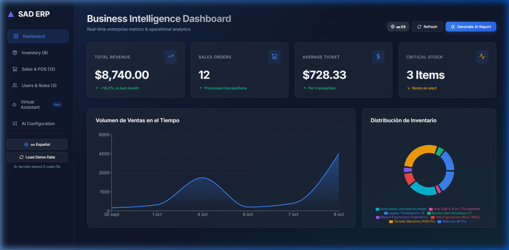
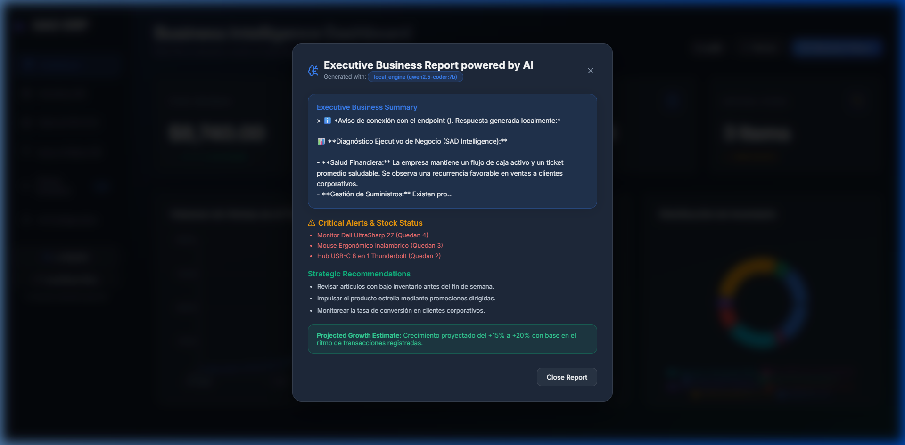
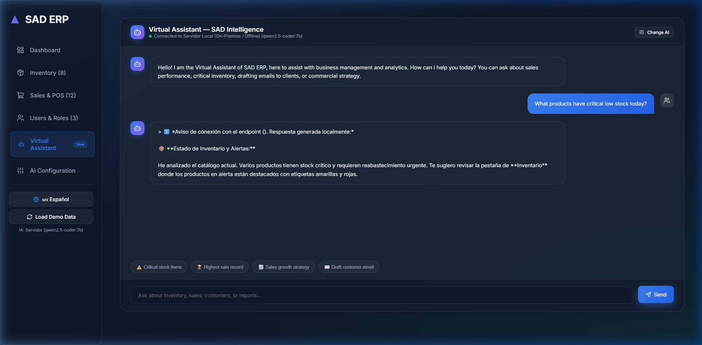
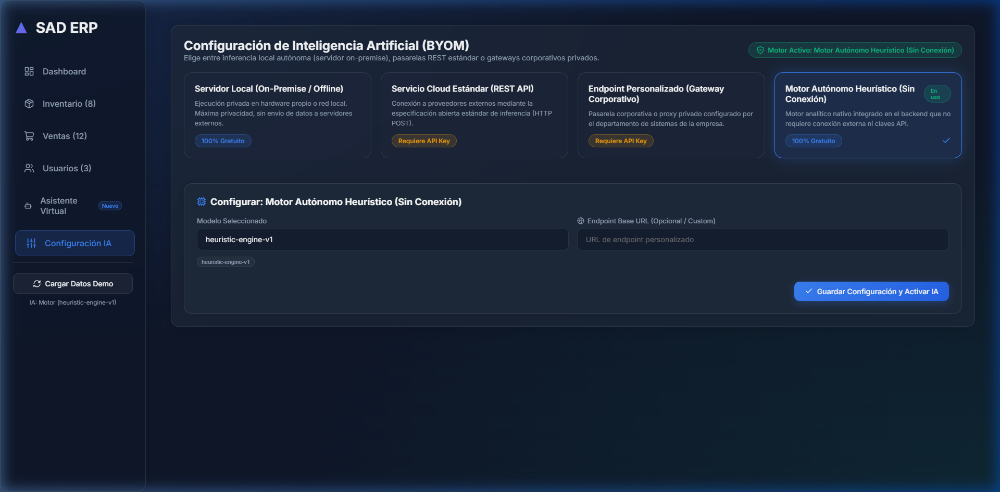
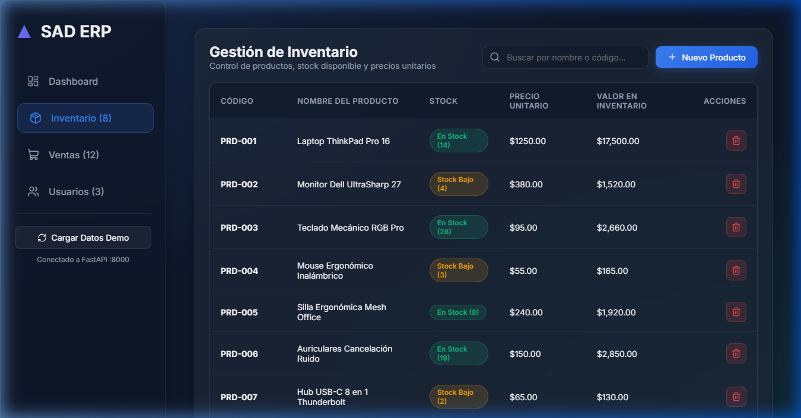
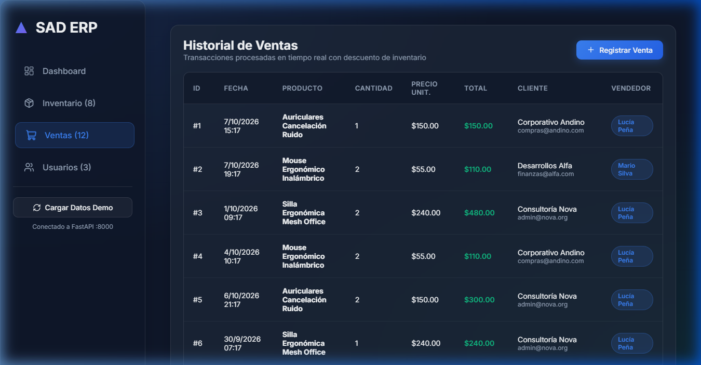
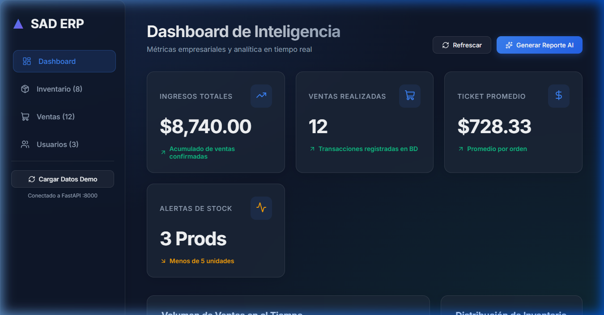
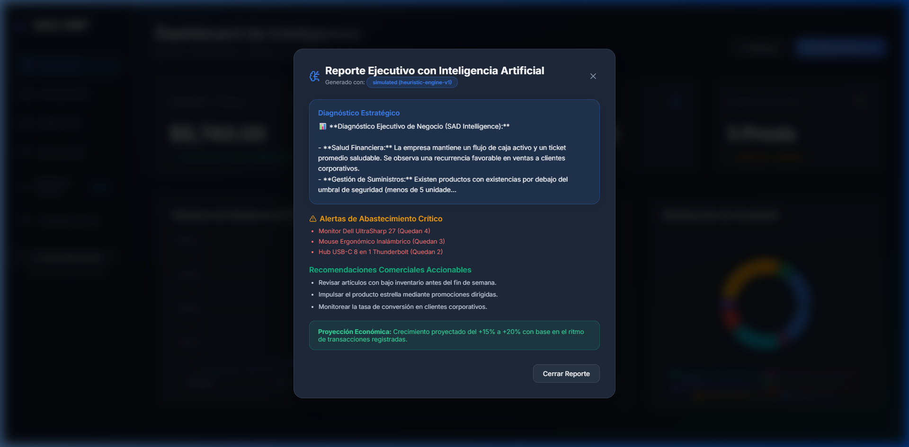
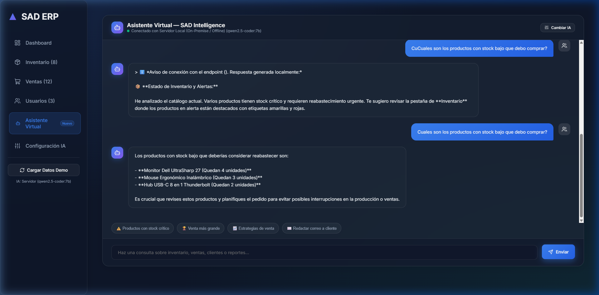

# ⚡ SAD ERP - Enterprise Management & Business Intelligence Platform
## Sistema de Administración y Analítica Empresarial con Inteligencia Artificial

<div align="center">

**[🇺🇸 English Documentation](#-english-documentation)** &nbsp;•&nbsp; **[🇲🇽 Documentación en Español](#-documentación-en-español)**

<br/>

[](https://github.com/GMA88/SAD/actions/workflows/ci.yml)


</div>

---

## 🇺🇸 English Documentation

### 🌟 Project Overview
**SAD ERP** is an enterprise-grade management and analytical platform re-engineered into a high-performance decoupled architecture:
- **Backend API:** Built with **FastAPI** + **SQLAlchemy** (PostgreSQL/SQLite ready) and strict **ACID transactional consistency** for inventory deduction, order ledger recording, and role-based access control.
- **Frontend SPA:** Built with **React 18** + **Vite**, featuring a modern dark Glassmorphism design system, interactive data visualizations via **Recharts**, and instant client-side **bilingual internationalization (English & Spanish)**.
- **AI-Powered Business Intelligence (BYOM - Bring Your Own Model):** Real-time database-grounded Virtual Assistant and automated Executive Business Reports supporting both **private on-premise local inference** (100% offline, e.g. Ollama `qwen2.5-coder:7b`) and standard cloud REST gateways with zero third-party vendor lock-in.
- **Modernization Case Study:** Preserves the architectural migration story from its original desktop version (Python + PyQt5 + MongoDB) to a scalable, containerized cloud web platform.

---

### 📸 System Preview

| 📊 Business Intelligence Dashboard | 🤖 AI Executive Diagnostic Report |
|:---:|:---:|
|  |  |

| 💬 Virtual Assistant (Context-Aware Chat) | ⚙️ Multi-AI Architecture (BYOM) |
|:---:|:---:|
|  |  |

| 📦 Inventory & Stock Control | 🛒 Point of Sale (POS Ledger) |
|:---:|:---:|
|  |  |

---

### 🚀 Key Features

#### 🌐 Instant Bilingual Support (i18n)
- One-click language switch between **English** and **Spanish** across all modules, forms, modals, table columns, and charts.
- **Language-Aware AI Assistant & Reports:** The Virtual Assistant dynamically adapts its system prompts and responses to English or Spanish depending on the active locale.

#### 🤖 Virtual Assistant & Multi-AI Architecture (BYOM)
- **Live Database Grounding:** Seamlessly queries inventory stock levels, transaction volume, revenue metrics, and star products in real-time.
- **Private On-Premise Inference (Local Engine):** Connects to local LLM servers (e.g., Ollama running `qwen2.5-coder:7b`, `llama3`, `phi4-mini`) with 120s adaptive timeout for cold starts and zero external data leaks.
- **Standard Cloud & Corporate Gateways:** Full compatibility with open REST HTTP `/chat/completions` specifications.
- **Autonomous Fallback Engine:** Built-in heuristic business analyzer ensures uninterrupted operation even without internet or network connections.

#### 📊 Business Intelligence Dashboard
- **Real-time Financial KPIs:** Total revenue, transaction count, average ticket size, and critical low-stock alerts.
- **Interactive Visualizations:** Historical revenue curves and inventory category distributions built with **Recharts**.

#### 🛒 Point of Sale (POS) with ACID Concurrency
- Validates real-time product availability before confirming any sale.
- Atomic stock deduction and accounting ledger registration prevent inventory drift and race conditions.

#### 📦 Inventory Management (CRUD)
- Full SKU tracking, unit pricing, real-time search, and automated visual badges for low stock (< 5 units) or stockouts.

#### 👥 Security & Role-Based Access Control (RBAC)
- Role authorization (*Administrator*, *Manager*, *Sales Representative*) with secure SHA-256 password hashing.

---

### 🛠 Tech Stack

| Layer | Technologies |
|---|---|
| **Frontend** | React 18, Vite, Lucide Icons, Recharts, Custom Glassmorphism CSS, Client-side i18n |
| **Backend** | Python 3.12, FastAPI, Pydantic v2, SQLAlchemy ORM, Uvicorn, Async HTTPX |
| **Containers & DevOps** | Docker, Docker Compose, Nginx Alpine, Multi-stage builds |
| **Database** | SQLite (development) / PostgreSQL ready |
| **Testing & CI/CD** | Pytest (10 integration tests passing), GitHub Actions CI Pipeline |
| **Legacy Desktop** | Python 3.x, PyQt5, MongoDB (`pymongo`) |

---

### ⚡ Quickstart Guide

#### Option A: Docker Compose (Recommended 🐳)
Spin up the complete multi-tier application (FastAPI backend + React/Nginx frontend) with one command:

```bash
docker compose up --build
```
- **Web Application:** [http://localhost:5173](http://localhost:5173)
- **Interactive OpenAPI / Swagger Docs:** [http://localhost:8000/docs](http://localhost:8000/docs)

#### Option B: Local Manual Execution
```bash
# 1. Backend Setup
python -m venv venv
venv\Scripts\activate       # Windows
# source venv/bin/activate  # Linux/macOS
pip install -r requirements.txt
uvicorn api.main:app --reload --port 8000

# 2. Frontend Setup (in a separate terminal)
cd frontend
npm install
npm run dev

# 3. Run Automated Test Suite
pytest -v
```

---
<br/>

## 🇲🇽 Documentación en Español

### 🌟 Resumen del Proyecto
**SAD ERP** es una plataforma integral de administración y analítica empresarial modernizada a una arquitectura desacoplada de alto rendimiento:
- **Backend RESTful:** Desarrollado con **FastAPI** + **SQLAlchemy** (compatible con SQLite y PostgreSQL) con **consistencia transaccional ACID** para control riguroso de inventario, libro de ventas y roles de usuario.
- **Frontend SPA:** Creado con **React 18** + **Vite**, interfaz moderna Glassmorphism en modo oscuro, analítica visual con **Recharts** e **internacionalización bilingüe instantánea (Español e Inglés)**.
- **Inteligencia de Negocios e IA (BYOM):** Asistente Virtual conectado a la base de datos empresarial y generador de Reportes Ejecutivos compatible tanto con **inferencia local on-premise** (100% privada y offline vía Ollama) como con pasarelas cloud REST estándar.
- **Caso de Modernización:** Conserva el código original de escritorio en Python + PyQt5 y MongoDB como caso de estudio de migración tecnológica hacia la web y la nube.

---

### 📸 Vista Previa del Sistema

| 📊 Dashboard de BI en Tiempo Real | 🤖 Diagnóstico Ejecutivo con IA |
|:---:|:---:|
|  |  |

| 💬 Asistente Virtual (Chat Contextual) | ⚙️ Configuración Multi-IA (BYOM) |
|:---:|:---:|
|  |  |

| 📦 Control de Inventario y Stock | 🛒 Punto de Venta y Transacciones |
|:---:|:---:|
|  |  |

---

### 🚀 Características Principales

#### 🌐 Soporte Bilingüe Instantáneo (i18n)
- Alternador de idioma con un solo clic entre **Español** e **Inglés** en toda la interfaz (navegación, métricas, tablas, modales y formularios).
- El Asistente Virtual y el Reporte Ejecutivo adaptan automáticamente su contexto y respuestas al idioma seleccionado.

#### 🤖 Asistente Virtual y Arquitectura Multi-IA (BYOM)
- **Contexto Vivo de la Base de Datos:** Responde en lenguaje natural preguntas sobre ingresos, rotura de inventario, mejores clientes y redacción de comunicaciones comerciales.
- **Inferencia Local On-Premise:** Compatible con servidores locales (Ollama `qwen2.5-coder:7b`, etc.) con timeout adaptativo de 120s y máxima confidencialidad sin salida a internet.
- **Pasarelas Cloud y Gateways Corporativos:** Conexión mediante la especificación abierta estándar REST HTTP `/chat/completions`.
- **Motor Autónomo Heurístico:** Motor analítico nativo integrado en el backend que opera sin dependencias externas ni internet.

#### 📊 Dashboard de Inteligencia de Negocios (BI)
- Métricas financieras en tiempo real: ingresos totales, volumen de ventas, ticket promedio y alertas de stock crítico.
- Gráficos interactivos de tendencias de facturación y distribución de inventario con **Recharts**.

#### 🛒 Punto de Venta (POS) con Transacciones ACID
- Deducción atómica de existencias y registro en libro contable al confirmar una venta, previniendo ventas sin inventario disponible.

#### 📦 Gestión de Inventario (CRUD)
- Catálogo de productos con código SKU, precio unitario y control de stock disponible. Alertas automáticas para inventario bajo (< 5 unidades) o agotado.

#### 👥 Administración de Usuarios y Seguridad
- Control de acceso basado en roles (*Administrador*, *Gerente*, *Vendedor*) con encriptación segura SHA-256.

---

### 📁 Estructura del Repositorio

```text
SAD/
├── .github/workflows/ci.yml # Pipeline de integración continua (GitHub Actions)
├── api/                     # Backend RESTful FastAPI
│   ├── main.py              # Punto de entrada de la API y rutas raíz
│   ├── database.py          # Configuración del motor SQLAlchemy
│   ├── models.py            # Modelos ORM (Usuarios, Inventario, Ventas, Finanzas)
│   ├── schemas.py           # Validaciones de entrada y salida con Pydantic v2
│   ├── routers/             # Módulos de rutas desacopladas (inventario, ventas, usuarios, ai)
│   └── services/            # Servicios de negocio e inferencia de IA
├── frontend/                # Frontend Web SPA (React + Vite)
│   ├── src/
│   │   ├── App.jsx          # Aplicación principal y gestión de estado
│   │   ├── translations.js  # Módulo de internacionalización i18n (EN/ES)
│   │   ├── index.css        # Sistema de diseño Glassmorphism
│   │   └── main.jsx         # Punto de montaje React
│   ├── Dockerfile           # Multi-stage build con Nginx para producción
│   ├── nginx.conf           # Servidor web y reverse proxy
│   └── package.json         # Dependencias del frontend
├── tests/                   # Suite de pruebas automatizadas
│   └── test_api.py          # 10 tests de integración (ACID, CRUD, Seguridad, IA Bilingüe)
├── docs/images/             # Capturas de pantalla de la aplicación
├── docker-compose.yml       # Orquestación de contenedores multi-servicio
├── Dockerfile.backend       # Imagen contenerizada del API FastAPI
├── requirements.txt         # Dependencias de Python
└── README.md
```

---

### ⚡ Guía de Ejecución

#### Opción A: Despliegue con Docker Compose (Recomendado 🐳)
```bash
docker compose up --build
```
- **Aplicación Web:** [http://localhost:5173](http://localhost:5173)
- **Documentación Swagger API:** [http://localhost:8000/docs](http://localhost:8000/docs)

#### Opción B: Ejecución Manual Local
```bash
# 1. Iniciar Backend
python -m venv venv
venv\Scripts\activate       # Windows
# source venv/bin/activate  # Linux/macOS
pip install -r requirements.txt
uvicorn api.main:app --reload --port 8000

# 2. Iniciar Frontend
cd frontend
npm install
npm run dev

# 3. Ejecutar Pruebas Automatizadas
pytest -v
```

---

## 👥 Autora / Author

**Andrea Varela Medina**
- **Location:** Salamanca, Guanajuato, México (Available for Remote Roles 🇲🇽 / 🇺🇸)
- **GitHub:** [@GMA88](https://github.com/GMA88)
- **LinkedIn:** [Andrea Varela](https://linkedin.com/in/andrea-varela-2058311a2)
